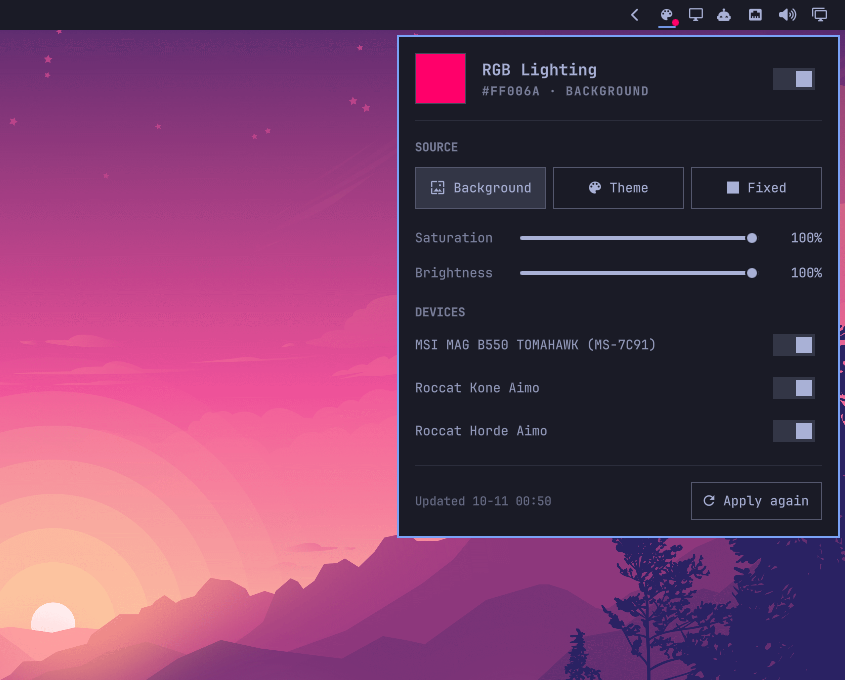
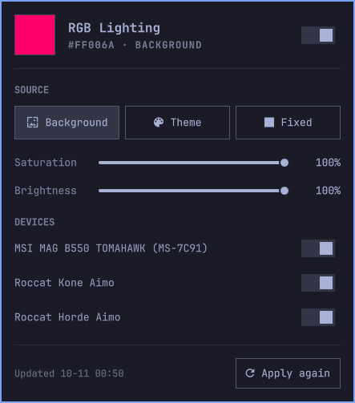

# RGB Sync for Omarchy

**Your PC lighting follows your desktop.** Switch the Omarchy theme or background and
your case, keyboard and mouse LEDs change color with it — automatically, via OpenRGB.



## Features

- **Follows your wallpaper** — picks the dominant hue from the top of the image
  (usually the sky) and pushes it to full saturation, so LEDs don't look washed out
- **…or your theme** — uses the theme's `accent` (or any other color from
  `colors.toml`, or the theme's own `keyboard.rgb`)
- **…or a fixed color** — picked from the current theme's palette
- **Bar widget** — the dot on the icon shows the current LED color; click for the
  panel, right-click to switch the lighting on or off
- **Every device, automatically** — all OpenRGB devices (case, keyboard, mouse,
  controllers, …) are detected on login and whenever something is plugged in or
  out; turn single devices off or fix boards with swapped color channels
- **No extra daemon** — a tiny service inside `omarchy-shell` reacts to theme and
  background changes (including `omarchy theme bg next`) and syncs on login
- **CLI included** — `omarchy-rgb` for scripts, hooks and keybindings



## Install

```bash
omarchy pkg add openrgb python-pillow inotify-tools
omarchy plugin add https://github.com/raimoghg/omarchy-rgb-sync.git --enable
```

The background service is mounted when the shell starts, so restart it once after
installing: `omarchy restart shell`.

OpenRGB needs access to your hardware first: make sure `openrgb -l` lists your
devices without `sudo` (see the OpenRGB docs for the i2c/udev setup on your
mainboard). The plugin syncs every device OpenRGB lists.

Optional, to use the CLI from a terminal:

```bash
ln -s ~/.config/omarchy/plugins/raimoghg.rgb-sync/bin/omarchy-rgb ~/.local/bin/omarchy-rgb
```

## Remove

```bash
omarchy plugin remove raimoghg.rgb-sync
rm -f ~/.local/bin/omarchy-rgb                                  # only if you created the symlink
rm -rf ~/.config/omarchy/rgb-sync.json ~/.local/state/omarchy-rgb  # settings and state
```

Removing the plugin leaves the LEDs at their last color. The plugin only writes its
own settings and state files listed above and never touches other configuration.

## CLI

```bash
omarchy-rgb status | jq              # settings, last state, missing dependencies
omarchy-rgb preview                  # compute the color without applying it
omarchy-rgb set source theme         # wallpaper | theme | fixed
omarchy-rgb set themeKey color4      # any key in colors.toml, or "keyboard"
omarchy-rgb set fixedColor '#00FFAA'
omarchy-rgb set brightness 0.6
omarchy-rgb on / off
omarchy-rgb sync --force
omarchy-rgb detect                   # re-detect devices, keeps per-device settings
omarchy-rgb device 0 channelOrder RBG               # by index from `omarchy-rgb detect`
omarchy-rgb device "Sony DualSense" enabled false  # or by name
```

## Configuration

Settings live in `~/.config/omarchy/rgb-sync.json`, state in
`~/.local/state/omarchy-rgb/state.json`.

| Key | Default | |
|---|---|---|
| `source` | `wallpaper` | `wallpaper`, `theme` or `fixed` |
| `themeKey` | `accent` | color key used by the theme source |
| `fixedColor` | `#FF00AA` | color used by the fixed source |
| `saturation`, `brightness` | `1.0` | 0–1 |
| `topFraction` | `0.55` | share of the wallpaper (from the top) that is analysed |
| `fallbackHue` | `330` | hue in degrees when the image has no clear color |
| `mode` | `direct` | OpenRGB mode |
| `devices` | detected | see below |

Per device: `name`, `enabled`, `zones` (`[]` = whole device) and `channelOrder`.
Some boards report swapped channels — if green and blue show up the wrong way
round, set `channelOrder` to `RBG` for that device.

Devices are matched by name, because OpenRGB's indices (`id`) change when another
device shows up first. New devices are enabled automatically; unplugged ones stay
in the list with `present: false`, so their settings are kept for next time.
Devices without the configured `mode` fall back to `Static`, or to their default
mode.

All devices are set in a single `openrgb` call; most of the ~5 s it takes is
OpenRGB scanning the hardware. When nothing changed the CLI returns immediately.

## License

MIT
